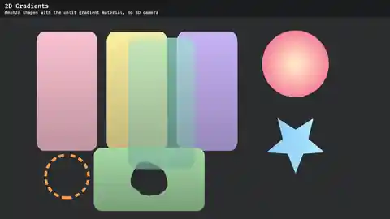
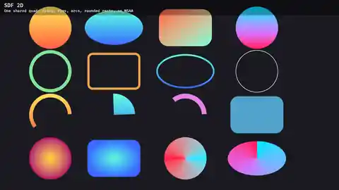
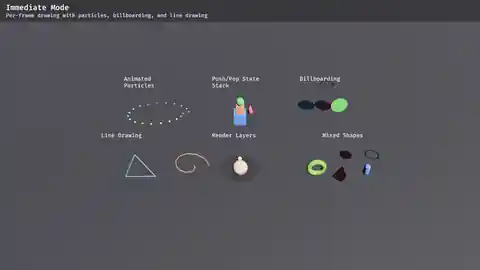
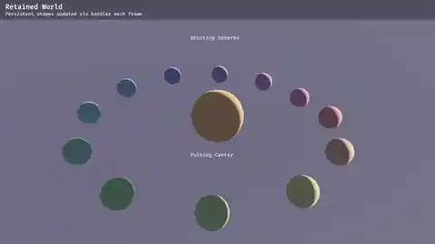
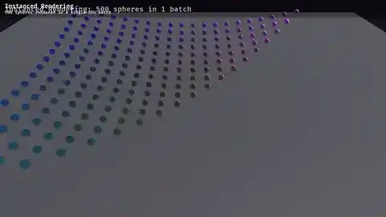
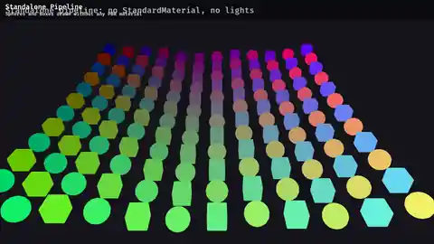
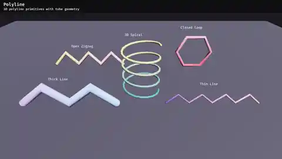
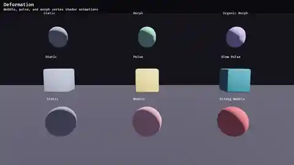
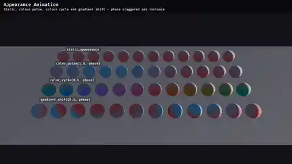

# BevyGradmesh

[](https://crates.io/crates/bevy_gradmesh)
[](https://docs.rs/bevy_gradmesh)
[](https://bevyengine.org/)
[](https://www.rust-lang.org/)
[](LICENSE-MIT)
[](https://github.com/xenacool/bevy_gradmesh/commits)

Procedural mesh generation and gradient materials for [Bevy](https://bevyengine.org/).

BevyGradmesh provides a clean API for generating procedural 3D primitives with proper geometry, detail levels, and gradient shading — inspired by Freya Holmér's work.

## Quick Start

```toml
[dependencies]
bevy_gradmesh = "0.3"
```

```rust
use bevy_gradmesh::Shape;
use bevy_gradmesh::Style;

// Generate a smooth sphere mesh
let mesh = Shape::sphere(1.0, ShapeDetail::Medium).build();

// Create a dual-directional gradient material
let material = Style::dual_directional(
    Color::srgb(0.6, 0.4, 0.3), // dark color
    Color::srgb(0.96, 0.8, 0.69), // light color
    Vec3::UP, // light direction
).build_material(&mut materials);
```

## Documentation

Read the [book](https://xenacool.github.io/bevy_gradmesh/) for a guided tour of the API,
or the [API reference on docs.rs](https://docs.rs/bevy_gradmesh).

## Gallery

| Screenshot | Example | Description |
|---|---|---|
|  | `shapes` | All procedural primitives with dual-directional gradient shading |
|  | `character_creator` | Character parts built from gradient-shaded primitives |
|  | `styles` | Opaque, transparent, additive, multiplicative, screen, dither, and dashed blend modes |
|  | `mix_spaces` | The same gradient in each `MixSpace` (OKLAB, OKLCH, linear RGB, sRGB) |
|  | `pbr_effects` | Transparency, emissive glow, metallic surfaces, and combined effects |
|  | `gradient_2d` | `Camera2d` and `Mesh2d` with gradient cards, a radial disc, a pulsing star, a dashed ring and a polygon with a hole |
|  | `sdf_2d` | One shared unit quad mesh: filled discs, ellipses, rounded rectangles, rims, animated partial arcs, radial and angular gradients |
|  | `sdf_dash_gallery` | Dashed rim outlines comparing `Off`, `Tiling`, `EndToEnd` and count-based snap modes |
|  | `immediate` | Per-frame animated particles, push/pop state stacking, billboarding, and line drawing |
|  | `retained` | Persistent shapes updated each frame via handles without recreating entities |
|  | `instanced` | 500 spheres rendered in a single GPU batch via `BatchRecorder` |
|  | `standalone` | Gradient shapes drawn without any PBR material or lights — one shader pipeline, one bind group |
|  | `curves` | Spline and parametric curves rendered as smooth tubes |
|  | `polyline` | Polylines with joint styles, width variation, gradient colors, and animated reveal |
|  | `sweep` | Profiles swept along 3D paths: a wall with an arched gate and windows, a kerbed road, and a tapering pipe on a helix |
|  | `road` | Banked road using `Shape::sweep_frames` with width and roll channels |
|  | `composed_shapes` | Compound tower, wall with arched opening, extruded cobbles, emissive torch, metallic gem, and translucent ghost piece |
|  | `terrain` | Heightfield chunks with shared edge normals, relative height bands, and hole edges |
|  | `deformation` | Vertex shader animations: wobble, pulse, and morph effects |
|  | `appearance` | Per-instance colour animation: static, pulse, cycle, and gradient shift |
|  | `arbitrary_shapes` | Custom polygons with per-vertex colors, star shapes, annular rings, pie-slice wedges, and tapered cylinders |

Run any example with `cargo run --example <name>`.

## License

Dual-licensed under MIT or Apache-2.0.

